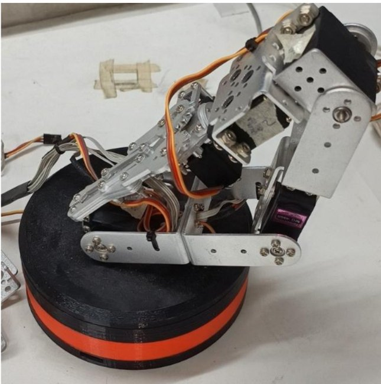
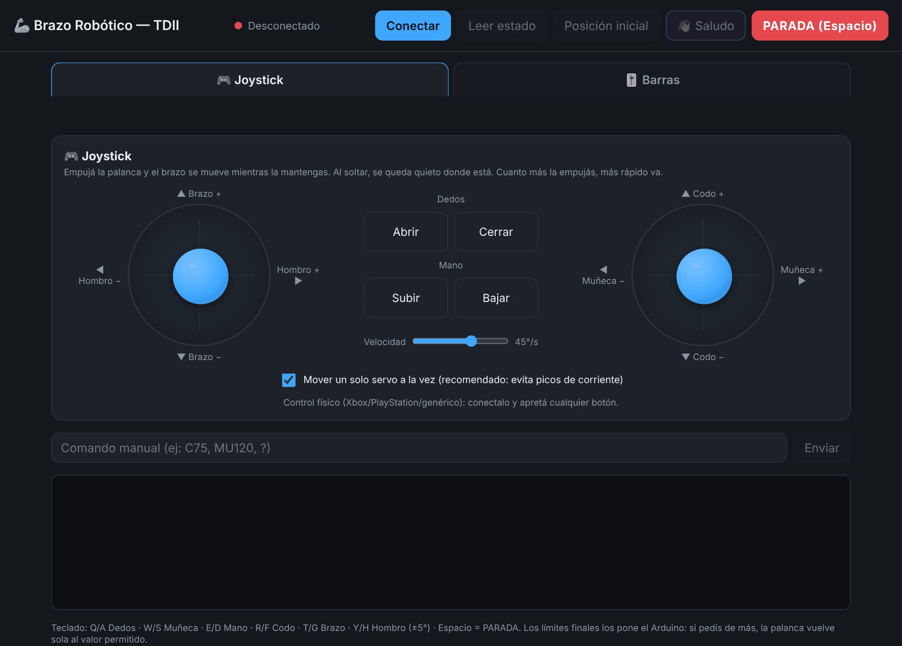
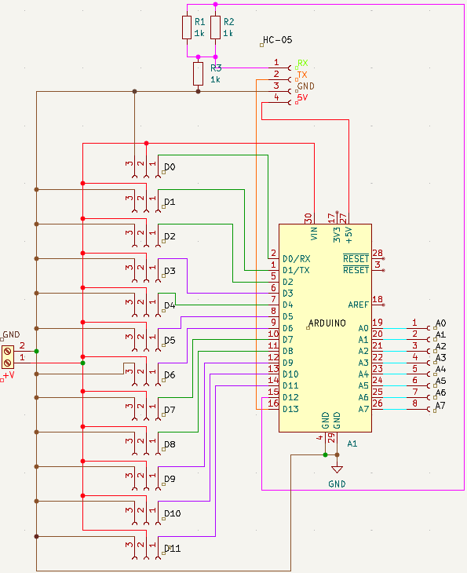
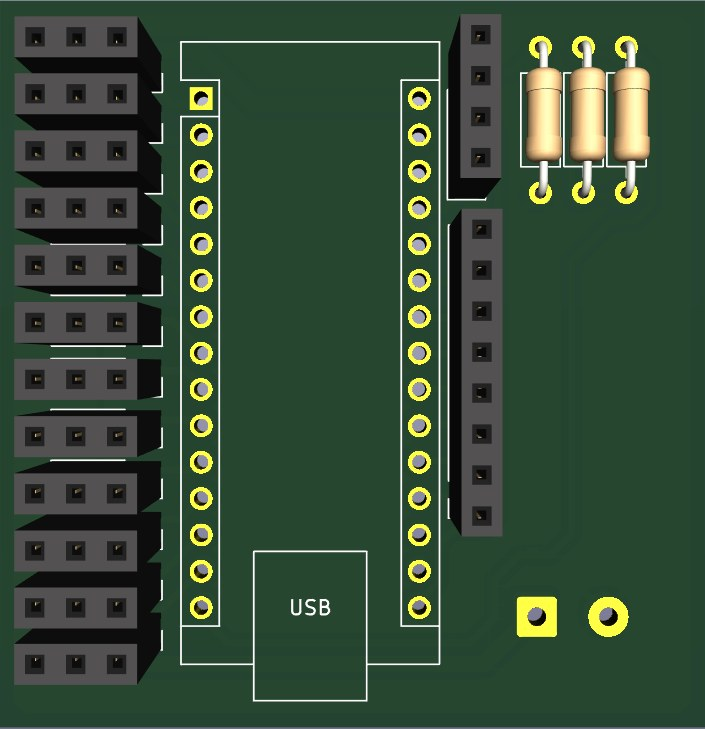
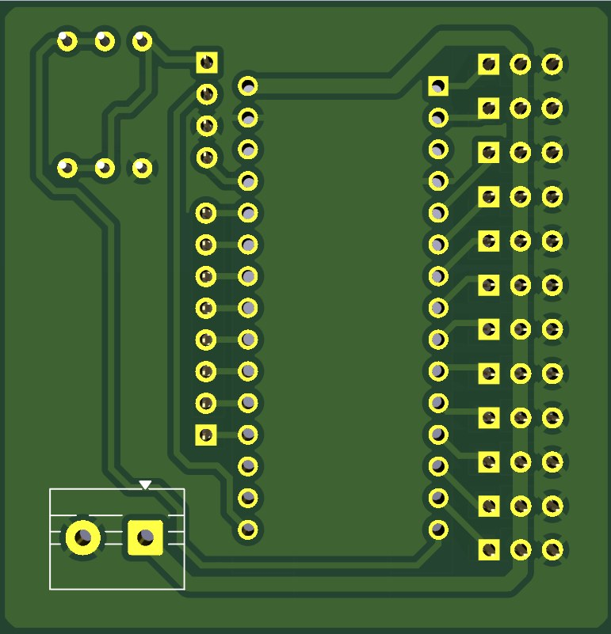
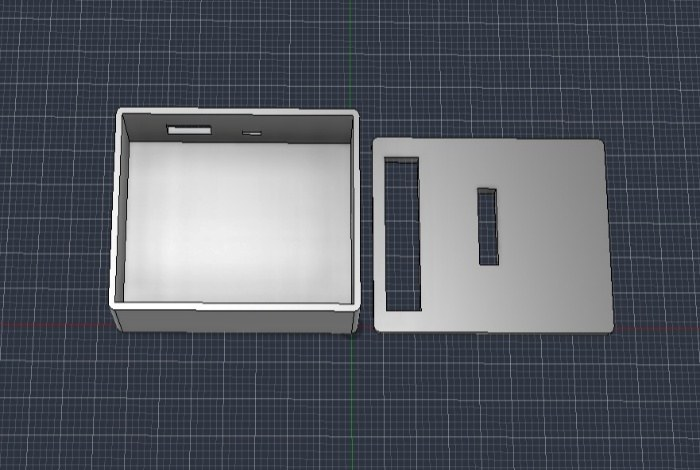

# Brazo robótico de 6 grados de libertad con control Bluetooth

Brazo robótico de seis articulaciones con servomotores MG996R, controlado por un Arduino Nano que
recibe comandos por Bluetooth (HC-05). Se maneja desde una **página web con joysticks y barras** que
funciona en la computadora y en Android. Incluye el firmware, la placa de control diseñada en KiCad,
la carcasa en Fusion 360 y la documentación técnica.

Desarrollado en el marco de una **beca de servicio 2026** del Laboratorio de Técnicas Digitales
(Ingeniería Electrónica, UTN Facultad Regional Paraná), como equipo para la asignatura
**Técnicas Digitales II**.

> **English summary.** Six-degree-of-freedom robotic arm (six MG996R servos) controlled by an Arduino
> Nano over Bluetooth (HC-05), operated from a web panel (Web Serial over Bluetooth) with on-screen
> joysticks, sliders and gamepad support. The firmware moves one joint at a time in 1° steps paced by a
> Timer2 interrupt, enforces per-joint safety limits with an elbow/arm interlock, stores the last
> position in EEPROM and reports the cause of every reset. Includes a custom KiCad PCB, a 3D-printed
> enclosure and technical documentation. Lab project, UTN Paraná, 2026.

  

> **Importante: alimentar por separado el Arduino y los servos.** Si el Nano toma energía del mismo riel que
> los MG996R, los picos de corriente de los servos lo reinician y el brazo "se cae". Con el Arduino
> alimentado aparte y GND común, los reinicios desaparecieron. Detalle en
> [`docs/alimentacion-y-reinicios.md`](docs/alimentacion-y-reinicios.md).

## Equipo

- **Franco Rufiner**, becario: desarrollo del proyecto.
- **Matias Vicentin**, becario de iniciación a la docencia (Técnicas Digitales I): supervisión
  técnica y revisión del desarrollo; diseño e impresión 3D de la carcasa.

## Panel web de control

[`web/control_brazo.html`](web/control_brazo.html) es una sola página, sin instalación, que se conecta
al HC-05 por Web Serial sobre Bluetooth.

- **Joystick:** el izquierdo mueve Hombro y Brazo; el derecho, Muñeca y Codo. Botones mantenidos para
  Dedos y Mano, regulador de velocidad y opción "un solo servo a la vez". Acepta un control físico
  (Xbox, PlayStation o genérico).
- **Barras:** un deslizador por articulación, con botones de ±5° y atajos de teclado.
- **Botones generales:** Leer estado, Posición inicial, Saludo y **PARADA** (también con Espacio o Esc).
- Funciona con Chrome o Edge en la computadora y con Chrome 138 o posterior en Android. No funciona en
  iPhone ni en Firefox.

**Uso:** emparejar el HC-05 desde el sistema (PIN 1234 o 0000), abrir la página, tocar **Conectar** y
elegir el HC-05. En la computadora se abre con doble clic; en Android tiene que estar publicada en una
dirección https (por ejemplo, con GitHub Pages).

## Firmware

[`firmware/brazo_robusto`](firmware/brazo_robusto/brazo_robusto.ino) es la versión actual:

- **Movimiento progresivo** de 1° cada 15 ms. La interrupción del Timer2 solo marca el tiempo y el
  movimiento se hace en `loop()`, así la rutina de interrupción no corrompe los bytes que recibe el
  SoftwareSerial.
- **Un servo a la vez:** los pedidos se ejecutan en el orden en que llegan, para evitar picos de
  corriente.
- **Seguridad entre Codo y Brazo:** si el Codo está fuera de 60–120°, primero vuelve a ese rango y
  recién después se mueve el Brazo.
- **Secuencias:** Saludo (`S`) y Posición inicial (`I`). La parada o cualquier comando manual las cancela.
- **Diagnóstico de reinicios:** al arrancar informa la causa (brown-out, encendido, reset o watchdog)
  por USB y por Bluetooth.
- **Memoria EEPROM:** guarda la última posición; después de un reinicio vuelve a donde estaba.
- **Uso de RAM:** textos en FLASH con `F()` y sin la clase `String`.
- **Recepción sin bloqueo:** el comando termina con Enter o tras 80 ms sin datos; `X` frena al instante.

Lista de comandos, rangos y conexión del HC-05 en
[`docs/comandos-bluetooth.md`](docs/comandos-bluetooth.md). La versión anterior del firmware y los
programas de prueba están en [`firmware/`](firmware/README.md).

## Hardware

- Arduino Nano (ATmega328P) sobre zócalo, en una PCB propia de 50 × 50 mm, dos capas, componentes
  through-hole.
- 12 conectores para servos (D0 a D11; el brazo usa D3, D5, D6, D9, D10 y D11), conector para el HC-05
  con divisor de tensión en su RX y conector para las entradas analógicas A0 a A7.
- Proyecto de KiCad y archivos de fabricación (Gerber y taladrado) en [`hardware/`](hardware/README.md).
  Lista de materiales en [`docs/Materiales_Brazo_Robotico.txt`](docs/Materiales_Brazo_Robotico.txt).

| Esquemático | PCB (vista 3D) | PCB (cobre, cara inferior) |
|---|---|---|
|  |  |  |

La carcasa que protege la electrónica se diseñó en Fusion 360 ([`cad/`](cad/README.md)) y se imprimió
en PLA en una Bambu Lab A1 del Laboratorio de Técnicas Digitales III:

## Estructura del repositorio

| Carpeta | Contenido |
|---|---|
| [`firmware/`](firmware/README.md) | Firmware actual (`brazo_robusto`), versión anterior y programas de prueba (Arduino IDE). |
| [`web/`](web/control_brazo.html) | Panel web de control. |
| [`hardware/`](hardware/README.md) | Proyecto de KiCad de la placa y archivos de fabricación. |
| [`cad/`](cad/README.md) | Carcasa de la electrónica (Fusion 360). |
| [`docs/`](docs/README.md) | Alimentación, comandos, manual técnico, limitaciones y lista de materiales. |

## Cómo usarlo

1. Armar la placa y conectar los servos según el manual técnico
   (`docs/Manual_Tecnico_Brazo_Robotico.pdf`), con el Arduino alimentado aparte y GND común.
2. Cargar `firmware/brazo_robusto` en el Nano con Arduino IDE (librerías `Servo`, `SoftwareSerial` y
   `EEPROM`, incluidas en el IDE). En clones del Nano, elegir *ATmega328P (Old Bootloader)*.
3. Abrir `web/control_brazo.html` y conectar al HC-05. También se puede controlar con cualquier
   terminal Bluetooth serie enviando los comandos de texto.

## Observaciones

- En la revisión actual de la PCB el Arduino Nano queda montado en posición invertida respecto de la
  prevista: hay que respetar la orientación indicada en el manual. Queda para la próxima revisión, junto
  con separar la alimentación del Nano del riel de los servos.
- Si alguna articulación se mueve al revés en el joystick, se corrige en `const INVERTIR` dentro del HTML.
